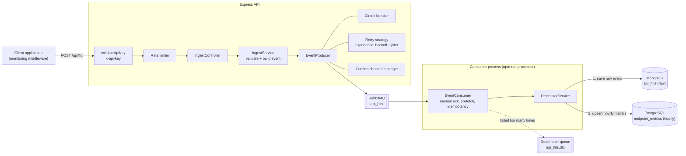

# Milestone 2 — Backend Implementation (Ingestion → Queue → Processor → Storage)

> **Branch:** `mileston-2` · **Project:** Intelligent API Monitoring & Alert System
> **Previous:** [Milestone 1 — Architecture & foundation](https://github.com/Latif1218/Intelligent-API-Monitoring-Alert-System/tree/mileston-1) · **Next:** [Milestone 3 — Anomaly detection & AI alerts](https://github.com/Latif1218/Intelligent-API-Monitoring-Alert-System/tree/mileston-3)

---

## 1. Goal of this milestone

Build the **complete backend data pipeline** on top of the Milestone 1 foundation, so the system can accept a high volume of API traffic data from many client applications **without slowing them down** and without losing data.

> This is the "scalability" part of the assignment: *handle multiple APIs / batch processing efficiently, proper error handling, logging.*

---

## 2. Architecture of this milestone



---

## 3. What was built

### 3.1 Ingestion API — `POST /api/hit`

External applications report one API call at a time.

- **Auth:** header `x-api-key: apim_...` (key created in Milestone 1). The middleware (`validateApiKey`) checks that the key exists, the client is active and the key has `canIngest` permission.
- **Rate limit:** `express-rate-limit` (window and max configurable with `RATE_LIMIT_WINDOW_MS` / `RATE_LIMIT_MAX_REQUESTS`) → `429` when exceeded.
- **Validation:** required fields, valid HTTP method, status code 100–599, latency ≥ 0.
- **Response:** `202 Accepted` (queued) or `503` when the circuit breaker is open.

Request body:

```json
{
  "serviceName": "PatientDataAPI",
  "endpoint": "/patients",
  "method": "GET",
  "statusCode": 200,
  "latencyMs": 120
}
```

```bash
curl -X POST http://localhost:5000/api/hit \
  -H "Content-Type: application/json" \
  -H "x-api-key: apim_your_key_here" \
  -d '{"serviceName":"PatientDataAPI","endpoint":"/patients","method":"GET","statusCode":200,"latencyMs":120}'
```

### 3.2 Reliable event publishing (`src/shared/events/producer/`)

| Component | Responsibility |
|---|---|
| `EventProducer` | Publishes `API_HIT` events to RabbitMQ |
| `ConfirmChannelManager` | Uses a confirm channel so the broker acknowledges every message |
| `RetryStrategy` | Exponential backoff **with jitter** (`RABBITMQ_RETRY_ATTEMPTS`, `RABBITMQ_RETRY_DELAY`) |
| `CircuitBreaker` | After repeated broker failures, stops calling the broker for a cool-down period (fail fast, return `503`) and then probes again (half-open) |
| `createEventProducer` | Factory that wires all of the above (dependency injection) |
| `eventContracts.js` | Single source of truth for event type names |

### 3.3 Consumer / Processor (`src/services/processor/`)

A **separate Node process** (run with `npm run processor`, own Docker image `Dockerfile.consumer`) that:

- consumes `api_hits` with **manual acknowledgements** and a **prefetch** limit
- validates every message with **Zod**
- is **idempotent** (duplicate message IDs are skipped)
- **retries** retryable failures with backoff, and routes non-retryable / exhausted messages to the **dead-letter queue** `api_hits.dlq` with the reason attached in headers
- detects "poison message" patterns and logs them
- auto-reconnects when the channel closes, and connects to the databases with retries

`ProcessorService` stores each event in two steps:

1. **Raw event → MongoDB** (`api_hits`) — critical step; failure triggers retry
2. **Aggregated metrics → PostgreSQL** (`endpoint_metrics`) — hourly buckets with `UPSERT` (total hits, error hits, avg/min/max latency); if this fails the raw event is still safe

### 3.4 Storage design

| Store | Collection / table | Purpose | Notes |
|---|---|---|---|
| MongoDB | `api_hits` | Every raw API call | Compound indexes for fast filtering; **TTL index** auto-deletes data after 30 days |
| PostgreSQL | `endpoint_metrics` | Hourly aggregates per client / service / endpoint / method | `UNIQUE(client_id, service_name, endpoint, method, time_bucket)` enables upsert |

### 3.5 Analytics read layer

`AnalyticsService`, `MetricsRepository`, controller and routes (`/stats`, `/dashboard`) that read from PostgreSQL: total hits, error rate, average latency, top endpoints, time series. These files are written in this milestone and **mounted in `server.js` in Milestone 3** so the dashboard can use them.

---

## 4. New / changed files in this milestone

```text
server/src/
├── services/
│   ├── ingest/       {routes, controller, services, Dependencies}
│   ├── processor/    {consumer.js, service, repository (ApiHit, Metrics, Base), Dependencies}
│   └── analytics/    {routes, controller, services, Dependencies}
└── shared/
    ├── events/       {eventContracts.js, producer/{EventProducer, CircuitBreaker, RetryStrategy, ConfirmChannelManager, createEventProducer}}
    └── middlewares/  validateApiKey.js
```

`server.js` change: `app.use("/api/hit", ingestRouter)`.

---

## 5. How to run this milestone

```bash
git checkout mileston-2
cd server
npm install
docker compose up -d postgres mongo rabbitmq      # infrastructure
npm run dev                                        # terminal 1: API on :5000
npm run processor                                  # terminal 2: queue consumer
```

`.env` (see Milestone 1 for the full block). Optional extras for this milestone:

```env
RATE_LIMIT_WINDOW_MS=900000
RATE_LIMIT_MAX_REQUESTS=1000
RABBITMQ_RETRY_ATTEMPTS=3
RABBITMQ_RETRY_DELAY=1000
```

**Try it end-to-end** (log in as super admin, onboard a client, create an API key, then send a hit):

1. `POST /api/auth/login` (saves the cookie) → `POST /api/admin/clients/onboard` → `POST /api/admin/clients/:clientId/api/keys` → copy the `apim_...` key
2. `POST /api/hit` with that key (command in §3.1) → response `202 queued`
3. Check the result: RabbitMQ UI (`:15672`) → queue activity; MongoDB collection `api_hits`; PostgreSQL table `endpoint_metrics`; consumer logs

---

## 6. Milestone 2 checklist

- [x] API-key protected, rate-limited ingestion endpoint
- [x] Input validation with clear `400` errors
- [x] RabbitMQ producer with confirms, retry/backoff and circuit breaker
- [x] Separate consumer process with ack, idempotency, retries and dead-letter queue
- [x] Raw storage (MongoDB, TTL) + aggregated storage (PostgreSQL, hourly upsert)
- [x] Analytics query layer (stats, top endpoints, time series)
- [x] Logging and error handling in every layer

---

## 7. Credits & learning resources

- Code-architecture tutorials by **[Code Architecture]([https://www.youtube.com/](https://www.youtube.com/@CodeArchitectureWithRahul))** — layered structure, event-driven design and resilience patterns.
