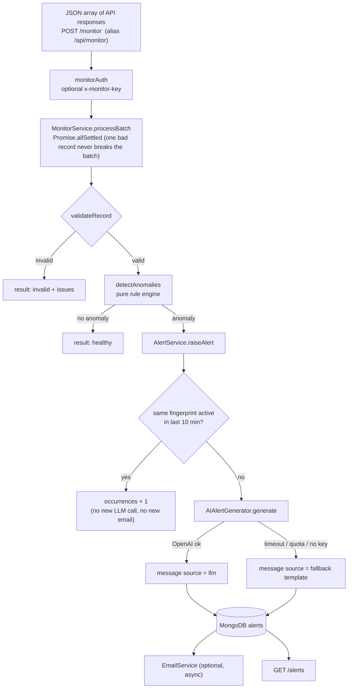

# Milestone 3 — Anomaly Detection, AI-Powered Alerts & Alert System

> **Branch:** `mileston-3` · **Project:** Intelligent API Monitoring & Alert System
> **Previous:** [Milestone 2 — Backend pipeline](https://github.com/Latif1218/Intelligent-API-Monitoring-Alert-System/tree/mileston-2) · **Next:** [Milestone 4 — Dashboard & final stack](https://github.com/Latif1218/Intelligent-API-Monitoring-Alert-System/tree/mileston-4)

---

## 1. Goal of this milestone

Implement the **core of the assignment**: automatically evaluate API responses, detect anomalies, generate **human-readable alerts with an LLM**, store them in a database and expose them through `GET /alerts`.

| Assignment requirement | Where it is implemented |
|---|---|
| 6.1 API health monitoring (time, status, data validation) | `monitor/validation/monitorSchema.js`, `alerts/detection/anomalyDetector.js` |
| 6.2 Anomaly detection (slow, failed, zero/missing records) | `alerts/detection/anomalyDetector.js` |
| 6.3 AI-powered alert generation | `alerts/ai/aiAlertGenerator.js`, `alerts/ai/promptTemplates.js` |
| 7.1 Store anomalies in a database | `shared/models/Alert.js` (MongoDB) + `AlertRepository` |
| 7.2 REST endpoint `/alerts` | `alerts/routes/alertRoutes.js` |
| 7.4 Optional: email reports | `alerts/notification/emailService.js` |
| Batch processing, error handling, logging | `MonitorService`, `errorHandler`, Winston |
| Input via `POST /monitor` | `monitor/routes/monitorRoutes.js` |

---

## 2. Architecture of this milestone



---

## 3. Features in detail

### 3.1 Input — `POST /monitor`

Accepts a JSON **array** (or a single object). Exactly the format from the assignment:

```json
[
  { "api_name": "PatientDataAPI", "response_time_ms": 1200, "status_code": 200, "records_returned": 50 },
  { "api_name": "AppointmentAPI", "response_time_ms": 5500, "status_code": 500, "records_returned": 0 }
]
```

- Numeric strings (`"300"`) are accepted and converted; `records_returned` may be omitted
- Empty body → `400`; more than `MONITOR_MAX_BATCH` (default 500) records → `413`
- Optional protection: set `MONITOR_API_KEY` and send it in the `x-monitor-key` header (Milestone 4 additionally allows a logged-in dashboard session)
- Response contains a **summary** (`received, healthy, anomalies, invalid, errors, durationMs`) and one **result per record** (`healthy | anomaly | invalid | error`)

### 3.2 Anomaly rules (`anomalyDetector.js`)

Pure functions — no database, no network, no LLM — so they are easy to unit-test.

| Condition | Anomaly type | Severity |
|---|---|---|
| HTTP status ≥ 500 | `SERVER_ERROR` | **critical** |
| HTTP status 400–499 | `CLIENT_ERROR` | warning |
| Response time ≥ critical threshold (default 5000 ms) | `HIGH_RESPONSE_TIME` | **critical** |
| Response time ≥ warning threshold (default 2000 ms) | `HIGH_RESPONSE_TIME` | warning |
| `records_returned` = 0 | `ZERO_RECORDS` | warning |
| `records_returned` missing | `MISSING_RECORDS` | warning |
| `records_returned` negative / not finite | `INVALID_DATA` | warning |

One record can trigger several anomaly types; the highest severity wins. Thresholds are configurable (`ALERT_WARN_RESPONSE_MS`, `ALERT_CRITICAL_RESPONSE_MS`).

### 3.3 Alert de-duplication (avoids alert storms)

A **fingerprint** (`ApiName::TYPE_A+TYPE_B`) identifies a problem. If an *active* alert with the same fingerprint was seen within `ALERT_DEDUPE_WINDOW_MIN` (default 10 minutes), the existing alert's `occurrences` counter and `lastSeenAt` are updated instead of creating a new document, calling the LLM again or sending another email.

### 3.4 AI alert generation (`aiAlertGenerator.js`)

- Calls the **OpenAI Chat Completions API** over plain HTTPS (no SDK); model from `LLM_MODEL` (default `gpt-4o-mini`)
- **System prompt** (in `promptTemplates.js`) tells the model to: write ONE short alert (max 2 sentences, plain text), start with the API name, use only the given facts (never invent numbers), end with a cautious likely cause / next step, and never mention personal data (healthcare context)
- **User prompt** contains the API name, status, response time, records, severity and the detected reasons
- **Resilience:** timeout (`LLM_TIMEOUT_MS`), retries with exponential backoff (`LLM_RETRIES`), no retry when the quota is exhausted
- **Never throws:** on any failure it returns a deterministic **template alert**, so no anomaly is ever lost. Each alert stores `messageSource` = `llm` or `fallback`
- Output is sanitised (markdown characters removed, max 500 chars)

Example result for the assignment sample:

> *AppointmentAPI failed with status 500 and returned 0 records. Possible outage or data issue.*

### 3.5 Storage — MongoDB `alerts` collection

`apiName, severity, anomalyTypes[], reasons[], metrics{responseTimeMs, statusCode, recordsReturned}, message, messageSource, status (active|resolved), fingerprint, occurrences, lastSeenAt, resolvedAt, emailSent` + timestamps, with indexes on status, severity, apiName and fingerprint.

### 3.6 REST API

| Method | Path | Description |
|---|---|---|
| POST | `/monitor` (or `/api/monitor`) | Submit a batch of API responses |
| **GET** | **`/alerts`** (or `/api/alerts`) | **Active anomalies** — query: `status=active\|resolved\|all`, `severity`, `apiName`, `page`, `limit` (max 100) |
| GET | `/alerts/stats` | Counts: active, critical, warning, AI-generated, top APIs |
| PATCH | `/alerts/:id/resolve` | Mark an alert resolved |

### 3.7 Optional: email reports

`nodemailer` (SMTP). A new (non-duplicate) alert triggers an email in the background — it never blocks the API response. (Email status / test-email endpoints and the dashboard page for them come in Milestone 4.) Subject: `[CRITICAL] AppointmentAPI: SERVER_ERROR, ...`. Enable with `ALERT_EMAIL_ENABLED=true`, `SMTP_*` and `ALERT_EMAIL_TO`.

### 3.8 Automated tests (`server/tests/`)

Built-in Node test runner (`npm test`):

- `anomalyDetector.test.js` — every rule, including the assignment's example record
- `monitorService.test.js` — mixed batches, one failing alert does not break the batch, `400`/`413` handling
- `aiAlertGenerator.test.js` — LLM success, fallback on failure/no key (mocked `fetch`)
- `emailService.test.js` *(added in Milestone 4)*

### 3.9 Other changes

- `server.js` now mounts analytics, monitor and alerts routes. They are mounted **before** the JWT-protected client router so the assignment endpoints `/monitor` and `/alerts` work as specified.
- Docker: `Dockerfile.consumer` for the queue consumer, MongoDB web UI (`mongo-express`), and alert / LLM / SMTP environment variables in `docker-compose.yml`.

---

## 4. New files in this milestone

```text
server/
├── Dockerfile.consumer
├── tests/                      {aiAlertGenerator, anomalyDetector, monitorService}.test.js
└── src/
    ├── services/
    │   ├── alerts/
    │   │   ├── detection/      anomalyDetector.js
    │   │   ├── ai/             aiAlertGenerator.js, promptTemplates.js
    │   │   ├── notification/   emailService.js
    │   │   ├── repository/     AlertRepository.js
    │   │   ├── service/        alertService.js
    │   │   ├── controller/     alertController.js
    │   │   ├── routes/         alertRoutes.js
    │   │   └── Dependencies/   dependencies.js
    │   └── monitor/            {validation, service, controller, routes, Dependencies}
    └── shared/models/Alert.js
```

---

## 5. How to run & try this milestone

```bash
git checkout mileston-3
cd server
npm install
docker compose up -d mongo            # MongoDB is enough for the alert system
npm run dev
```

Add to `server/.env`:

```env
ALERT_WARN_RESPONSE_MS=2000
ALERT_CRITICAL_RESPONSE_MS=5000
ALERT_DEDUPE_WINDOW_MIN=10
MONITOR_MAX_BATCH=500
MONITOR_API_KEY=

OPENAI_API_KEY=sk-...        # leave empty to use template alerts
LLM_MODEL=gpt-4o-mini
LLM_TIMEOUT_MS=8000
LLM_RETRIES=2

ALERT_EMAIL_ENABLED=false    # true + SMTP_* + ALERT_EMAIL_TO to send emails
```

> Without PostgreSQL/RabbitMQ the server starts in **lite mode** (alerts work; hit analytics disabled).

**Send the assignment example:**

```bash
curl -X POST http://localhost:5000/monitor \
  -H "Content-Type: application/json" \
  -d '[{"api_name":"PatientDataAPI","response_time_ms":1200,"status_code":200,"records_returned":50},
       {"api_name":"AppointmentAPI","response_time_ms":5500,"status_code":500,"records_returned":0}]'

curl http://localhost:5000/alerts
```

Expected: `PatientDataAPI` → `healthy`; `AppointmentAPI` → `anomaly` (critical: `SERVER_ERROR`, `HIGH_RESPONSE_TIME`, `ZERO_RECORDS`) with a readable message. Send the same batch again → `deduplicated: true`, `occurrences` increases.

Run the tests:

```bash
npm test
```

---

## 6. Milestone 3 checklist

- [x] Input validation and batch processing (`POST /monitor`)
- [x] Rule-based anomaly detection with severity levels
- [x] LLM-generated alerts with timeout, retry and guaranteed fallback
- [x] Alert storage in MongoDB with de-duplication
- [x] `GET /alerts` (+ filters, pagination, stats, resolve)
- [x] Optional email notifications
- [x] Unit tests for detection, batch service and AI generator
- [x] Logging and centralised error format

---

## 7. Credits & learning resources

- Code-architecture tutorials by **[Channel Name](https://www.youtube.com/)**.
