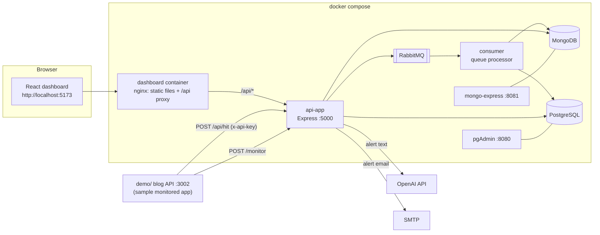

# Milestone 4 — Dashboard, Demo Client & Full Docker Stack

> **Branch:** `mileston-4` · **Project:** Intelligent API Monitoring & Alert System
> **Previous:** [Milestone 3 — Anomaly detection & AI alerts](https://github.com/Latif1218/Intelligent-API-Monitoring-Alert-System/tree/mileston-3) · **Final result:** [`main` branch](https://github.com/Latif1218/Intelligent-API-Monitoring-Alert-System)

---

## 1. Goal of this milestone

Make the system **usable and demonstrable**: a clean, user-friendly **dashboard** (assignment §7.3), a **demo client application** that shows how a real API plugs into the monitor, and a **one-command Docker deployment** of the whole stack. A few backend additions support the UI (email status/test endpoints, helper scripts).

---

## 2. Final architecture (everything running)



---

## 3. What was built

### 3.1 React dashboard (`dashboard/`)

**Stack:** React 18 · Vite 5 · React Router 7 · TanStack Query 5 · Axios · ApexCharts (`react-apexcharts`) · SCSS modules · lucide-react icons.

| Page | Route | Who sees it | What it shows |
|---|---|---|---|
| **Overview** | `/` | everyone | Stats cards (total hits, error rate, avg latency…), hits chart, status distribution, top endpoints |
| **Alerts** | `/alerts` | everyone | **AI-generated alert cards** with severity badge, anomaly types, metrics, occurrence count; filters (severity / status); pagination; *Resolve* button; auto-refresh every 10 s; **"Test the monitor" card** to POST sample JSON to `/monitor` from the UI |
| **Notifications** | `/notifications` | everyone | Email configuration status (masked address, no secrets), sent/failed counters, **send test email** |
| **API Hit Monitor** | `/hit-monitor` | admins | Send sample or custom hits with an API key and watch them flow through the queue |
| **Clients / My Client** | `/clients`, `/clients/:id` | admins | Onboard clients, create client users, create/copy API keys |
| **Super Admins** | `/users` | super admin | Create more super admin accounts |
| **Settings** | `/settings` | everyone | Theme selector (multiple themes, saved in the browser) |

Quality details: lazy-loaded routes, **role-based route guards**, error boundary, toast notifications, loading / error / empty states, responsive layout, first-time **"Create the super admin"** screen on the login page, session through the httpOnly cookie (auto sign-out on `401`).

### 3.2 Backend additions for the UI

- `GET /alerts/email-status` (masked SMTP setup, no secrets) and `POST /alerts/email-test` (sends a test email) — login required
- `/monitor` can now also be called from a **logged-in dashboard session** (in addition to the optional `x-monitor-key` header)
- `GET /api/admin/clients` — lists clients (super admin: all; client users: only their own) for the Clients pages
- Helper scripts: `npm run seed:admin` (creates the first super admin) and `npm run send:sample -- <file.json>` (posts a JSON file to `/monitor`)
- New test file `tests/emailService.test.js`

### 3.3 Demo client app (`demo/`)

A small **Blog API** (Express) that shows how any existing service integrates with the monitor — with **no changes to its business code**:

- `monitoring.js` — middleware that measures every request and sends it asynchronously to `POST /api/hit` with an API key (non-blocking)
- `middleware/apiMonitor.cjs` — middleware that sends the **assignment format** (`api_name`, `response_time_ms`, `status_code`, `records_returned`) to `POST /monitor`; it counts returned records automatically and groups URLs by route pattern (`GET /posts/:id`)
- Mock blog endpoints (`/api/posts`, `/api/posts/:postId/comments`) with simulated, varying response times to generate realistic traffic

### 3.4 Docker (full stack)

`server/docker-compose.yml` now starts everything: PostgreSQL, MongoDB, mongo-express, RabbitMQ, pgAdmin, **api-app**, **consumer** and **dashboard** (nginx serving the production build and proxying `/api` to the API container).

| Service | URL / port |
|---|---|
| Dashboard | http://localhost:5173 |
| API | http://localhost:5000 |
| Demo app (run locally) | http://localhost:3002 |
| RabbitMQ UI | http://localhost:15672 |
| Mongo Express | http://localhost:8081 |
| pgAdmin | http://localhost:8080 |

---

## 4. New files in this milestone

```text
dashboard/                       # React app (Dockerfile, nginx.conf, vite.config.js)
├── src/api/api.js               # axios client + all API calls
├── src/pages/                   # Overview, Alerts, Notifications, HitMonitor, Clients, ClientDetail, AdminUsers, Settings
├── src/components/              # alerts/, charts/, layout/, ui/, Login, StatsGrid, TopEndpoints …
├── src/contexts/                # Auth, Theme, Toast
├── src/hooks/                   # TanStack Query hooks
└── src/styles/                  # SCSS design tokens + modules
demo/                            # sample monitored Blog API
server/scripts/                  # seed-admin.js, send-sample.js
server/tests/emailService.test.js
```

---

## 5. How to run this milestone

### Option A — everything in Docker (recommended)

```bash
git checkout mileston-4
cd server
```

Create `server/.env` (Docker Compose reads it for variable substitution):

```env
PG_PASSWORD=latif
JWT_SECRET=change-me-to-a-long-random-string
# Optional AI + email
OPENAI_API_KEY=
LLM_MODEL=gpt-4o-mini
ALERT_EMAIL_ENABLED=false
SMTP_HOST=
SMTP_PORT=587
SMTP_USER=
SMTP_PASS=
SMTP_FROM=
ALERT_EMAIL_TO=
```

```bash
docker compose up --build -d
```

Open **http://localhost:5173** → click **"First time here? Create the super admin account"** → sign in → open **Alerts** → use the **Test the monitor** card (pre-filled with the assignment's sample JSON) and press **Run monitor**.

> The seed script is an alternative to the setup screen. The password must satisfy the policy: `ADMIN_PASSWORD=Admin@12345 npm run seed:admin` (PowerShell: `$env:ADMIN_PASSWORD="Admin@12345"; npm run seed:admin`).

### Option B — local development

```bash
# terminal 1 – infrastructure
cd server && docker compose up -d postgres mongo rabbitmq

# terminal 2 – API
cd server && npm install && npm run dev

# terminal 3 – queue consumer (optional, for hit analytics)
cd server && npm run processor

# terminal 4 – dashboard
cd dashboard && npm install && npm run dev        # http://localhost:5173 (proxies /api → :5000)
```

### Run the demo app

```bash
cd demo
npm install
# .env → PORT, SERVICE_NAME, MONITORING_API_KEY (from the dashboard), MONITORING_ENDPOINT=http://localhost:5000/api/hit
npm start
```

Then call its endpoints (e.g. `GET http://localhost:3002/api/posts`) and watch traffic and alerts appear on the dashboard.

---

## 6. Milestone 4 checklist

- [x] User-friendly dashboard for alerts (filters, severity, auto-refresh, resolve)
- [x] Analytics overview with charts
- [x] Email notification status + test email page
- [x] Role-based navigation and route protection
- [x] Demo client application with monitoring middleware
- [x] Full-stack Docker Compose (one command)
- [x] Seed and sample-data scripts

---

## 7. Credits & learning resources

- Code-architecture tutorials by **[Channel Name](https://www.youtube.com/)**.
